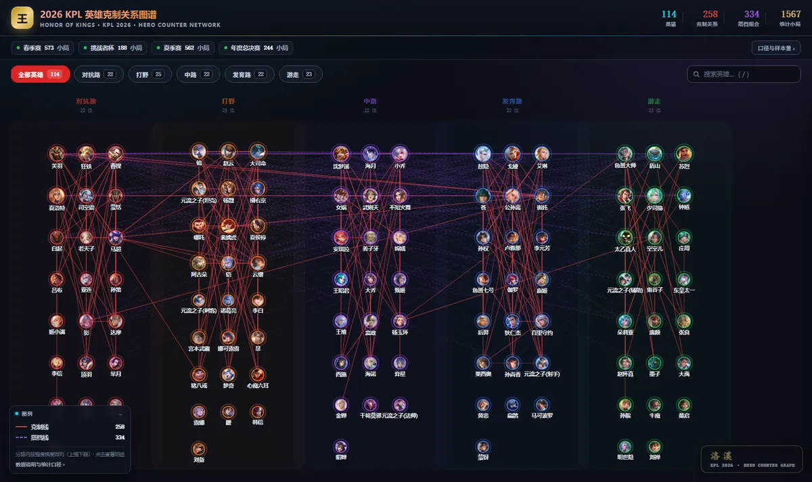

# 2026 KPL 英雄克制关系图谱

[](https://louxiiiii.github.io/kpl2026-hero-graph/)
[](#数据范围)
[](#机制克制)

把 2026 年王者荣耀 KPL 四大赛事的**逐局 BP 数据**和**官方英雄机制说明**合成一张可分路浏览的关系图谱：
114 位英雄 · 258 条同路对位克制 · 334 条同队搭档 · 机制关系 114/114 全覆盖。

**在线地址 → https://louxiiiii.github.io/kpl2026-hero-graph/**



## 特性

- **两套口径可切换**：抽屉顶部「全部 / 赛场 / 机制」——赛场是 KPL 逐局胜负统计，机制是官网技能克制说明
- **强度梯度排布**：每条分路从上到下就是 T0 → T3，分数 = 0.45×禁用率 + 0.35×出场率 + 0.20×胜率超额
- **单文件离线可用**：`index.html` 内联 CSS / JS / d3 / 数据 / 130 张头像，双击即开、无外部请求
- **手机端**：面板为底部抽屉（可下滑关闭）、分路胶囊横滑、点关系项自动滚动到对应英雄
- **只读外部英雄**：15 位未在 2026 KPL 出场的英雄作为机制关系对象展示，标注「未在 2026 KPL 出场」，点击不跳转

## 数据范围

| 赛事 | 系列赛 | 小局 | 数据粒度 |
| --- | --- | --- | --- |
| 2026 KPL 春季赛 | 136 | 573 | 逐局阵容 + BP |
| 2026 KPL 挑战者杯 | 38 | 188 | 逐局阵容 + BP |
| 2026 KPL 夏季赛 | 136 | 562 | 逐局阵容 + BP |
| 2026 KPL 年度总决赛 | 54 | 244 | 逐局阵容 + BP |
| **合计** | **364** | **1567** | 1547 局含完整 BP |

- 数据来自 KPL 官方赛事接口 `prod.comp.smoba.qq.com/leaguesite`（即 pvp.qq.com/matchdata 页面调用的同一套接口）
- 与官方赛季英雄榜交叉核对：禁用数逐位一致，胜率差 ≤0.02，出场数差 ≤2%

## 机制克制

取自王者荣耀官网「英雄资料 · 英雄关系」的 压制英雄 / 被压制英雄 / 最佳搭档 及官方理由文案。

> 关键点：新英雄的资料页是**拼音 slug**（`herodetail/wangwei.shtml`），不是数字 id（`herodetail/138.shtml` 会 404）。slug 在 `herolist.json` 的 `id_name` 字段里。

| 项目 | 数量 |
| --- | --- |
| 覆盖英雄 | 114 / 114 |
| 压制 / 被压制 / 搭档 | 188 / 164 / 194 |
| 双向对称补全 | +528 |

## 强度梯度

```
score = 0.45 × 禁用率(归一) + 0.35 × 出场率(归一) + 0.20 × 胜率超出 45% 的部分(0~1)
T0 = 前 10%   T1 = 10–30%   T2 = 30–60%   T3 = 其余
```

第一名鲁班大师 0.815（禁用率 82%）；T0 12 位、T1 23 位、T2 34 位、T3 45 位。

## 仓库结构

```
.
├── index.html            # 站点（单文件，构建产物）
├── preview.webp          # README 预览图
└── pipeline/             # 数据与构建脚本
    ├── fetch-official.mjs    # 拉 KPL 官方逐局数据 → raw/official-*.json
    ├── fetch-relations.ps1   # 按 slug 抓官网英雄资料页 → raw/relations/*.html
    ├── fetch-icons.ps1       # 下载缺失的英雄头像
    ├── parse-relations.mjs   # 解析「英雄关系」→ raw/relations.json
    ├── normalize-icons.mjs   # 校正头像扩展名 → icon-ext.json
    ├── optimize-icons.py     # 头像压成 64px WebP（2.7MB → 225KB）
    ├── build.mjs             # 聚合：赛场关系 + 机制关系 + 强度梯度 → data.js
    ├── build-standalone.mjs  # 打包成单文件 index.html
    └── make-preview.py       # 生成 preview.webp
```

## 本地运行 / 更新

```powershell
# 本地预览（可选）
node serve.mjs        # http://127.0.0.1:8788/

# 更新数据（三步）
node pipeline/fetch-official.mjs      # 拉最新赛程与逐局 BP
powershell -File pipeline/fetch-relations.ps1
node pipeline/parse-relations.mjs

# 重新构建
node pipeline/build.mjs
node pipeline/build-standalone.mjs    # 生成单文件 index.html
```

## 说明

- 所有关系数字由脚本从官方数据聚合，没有人工编写的关系描述
- 克制关系是**赛场结果的统计**（同路对位胜负倾向），不等同于版本机制上的绝对克制
- 机制关系描述技能层面克制，与赛场统计相互独立，请勿混读
- 右下角水印保留参考站原作者署名「洛溪」
